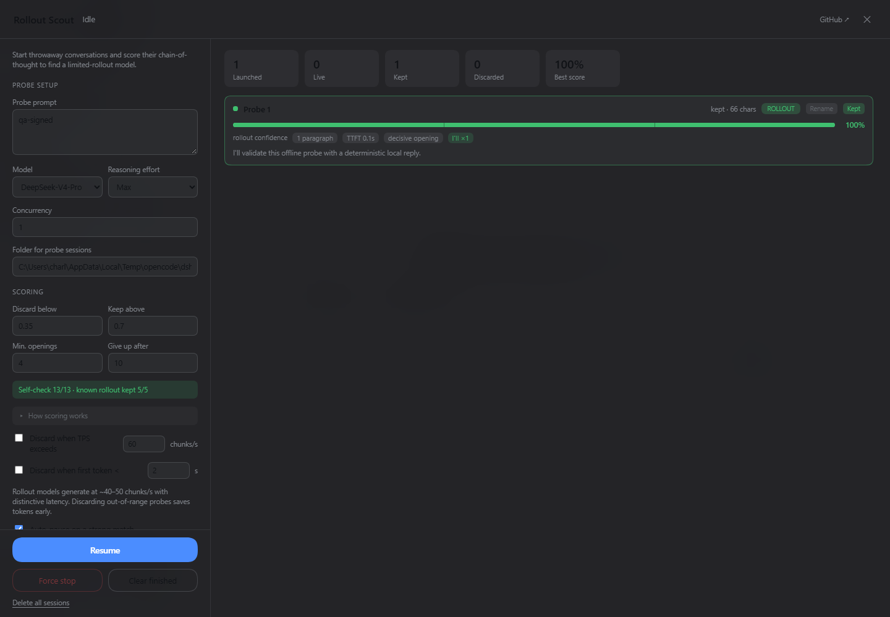
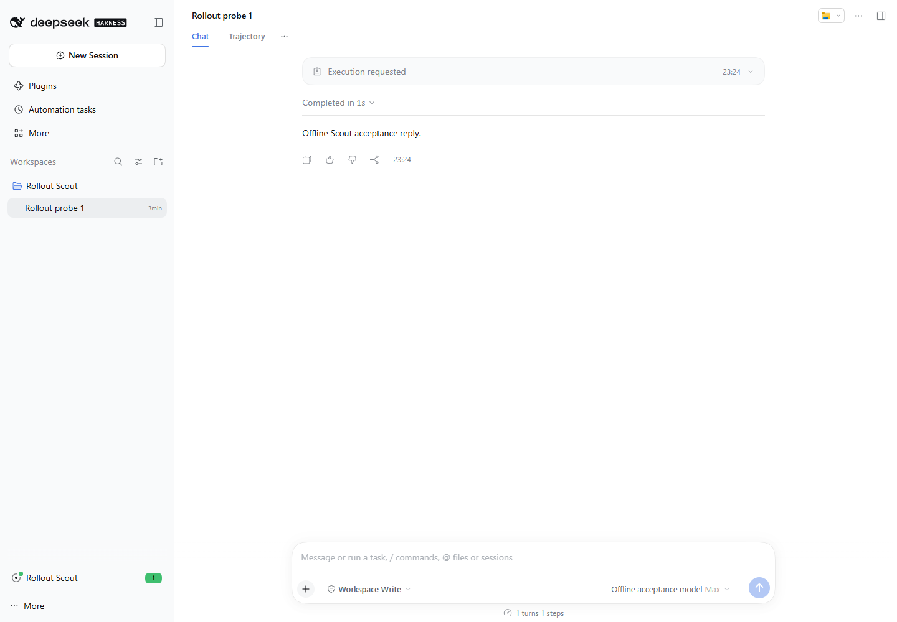

# DSH 0.2.1-rc.5 compatibility

Reviewed on 2026-10-31 against official DSH `0.2.1-rc.5` (tag [`dsh-v0.2.1-rc.5`](https://github.com/deepseek-ai/deepseek-harness/releases/tag/dsh-v0.2.1-rc.5), commit `b830ec950faba0a46dda564be3e2d854afed94f1`). Retains compatibility with `0.2.0-rc.2` and `0.2.1-rc.2`.

Declared host range: `>=0.2.0-rc.2 <0.3.0-0 || 0.2.1-rc.2 || 0.2.1-rc.5`.

## Summary of changes

1. **Signed reasoning stream handling**: DSH rc.5 models introduce a leading signature envelope in streaming reasoning frames. Scout strips the leading signature envelope so that it cannot conceal the initial prose opening, trigger a false model-discard verdict, pollute the live preview, or inflate prose timing calculations. Split CRLF boundaries and fragmented tags are handled, while subsequent markup and plain text are preserved. Raw streaming frames remain intact in official host JSONL persistence.
2. **Client workspace navigation**: Replaced invocation of nonexistent `sessions.open` with `uiWorkspace.openSession` from `@deepseek-ai/dsh-client-ui-workspace`. This pre-existing defect in published 1.7.0 prevented client activation across all official runtimes; the fix restores sidebar launcher activation and probe card navigation on `0.2.0-rc.2`, `0.2.1-rc.2`, and `0.2.1-rc.5`.

## Validation

- **Automated tests and packaging**:
  - `npm ci` cleanly installs dependencies.
  - `npm test` passes all 27 test suites (including reasoning parser fuzzing and edge cases, stream events, client loading, and Cordis patch checks).
  - `npm run build` and `npm run check:client` pass with clean generated bundle.
  - `npm run check:package` verifies 11 runtime package files without test or development artifacts.
  - `node --test scripts/npm-publish.test.mjs` passes all 10 publishing workflow checks.

- **Official runtime acceptance**:
  - `node scripts/run-dsh-acceptance.mjs` executed fresh-boot and restart acceptance tests across all three official runtimes (`0.2.0-rc.2`, `0.2.1-rc.2`, `0.2.1-rc.5`) independently.
  - Verified plain and signed streaming without duplicate counting, maximum reasoning effort, plugin-owned message source (`dsh-plugin-rollout-scout`), auto-pause upon probe completion, prose-only preview, raw signed JSONL stream persistence, cold rename, protected cleanup preservation, explicit unprotect deletion, restart retention, three-failure breaker, and orphan cleanup.

- **Browser UI verification**:
  - Validated in an isolated headless Microsoft Edge Guest process against the official rc.5 Web host (`http://127.0.0.1:61490`).
  - Verified sidebar footer launcher activation, signed probe prose-only preview (66 characters, 100% confidence), and card navigation opening the persisted conversation with the local adapter response.
  - Zero console errors and zero failed network requests.

## Scope and limitations

- Validation was performed on the official Web runtime using a deterministic local LLM adapter; no remote model service, real account quota, or native Desktop app environment was exercised.
- Older runtimes (`0.2.0-rc.2` and `0.2.1-rc.2`) were verified via official server API acceptance and fresh/restart lifecycle checks; they were not run through separate browser UI sessions.
- The navigation bug was pre-existing in published 1.7.0 (where client activation failed across all runtimes due to the missing `sessions.open` method); the fix benefits all supported runtimes, not only rc.5.
- Baseline navigation failure was isolated via API analysis and initial client failure logs rather than re-running a full broken browser session for baseline screenshots.
- Reviewer host startup initially encountered a relative path resolution issue with the test sandbox root, which was corrected to an absolute path.
- Temporary localhost tokens emitted during review tool execution expired upon stopping the test host; none were retained or leaked.
- All test processes, ports, browser profiles, and sandbox roots were stopped and cleaned up.
