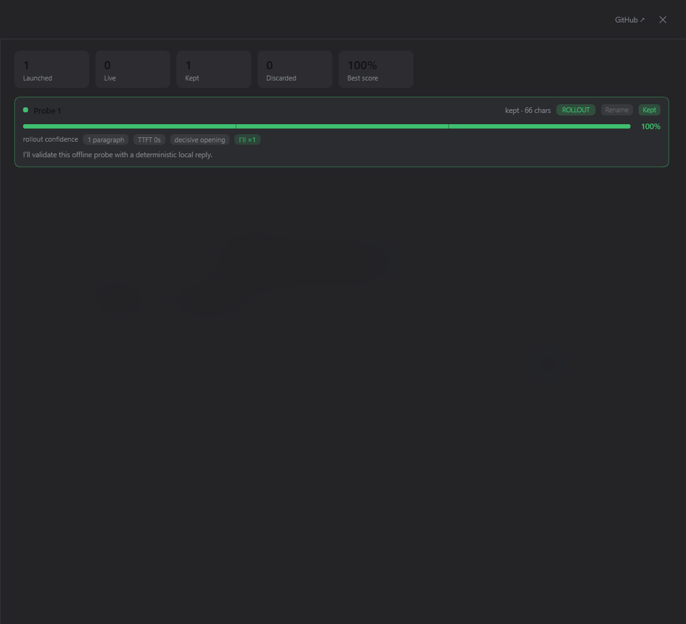
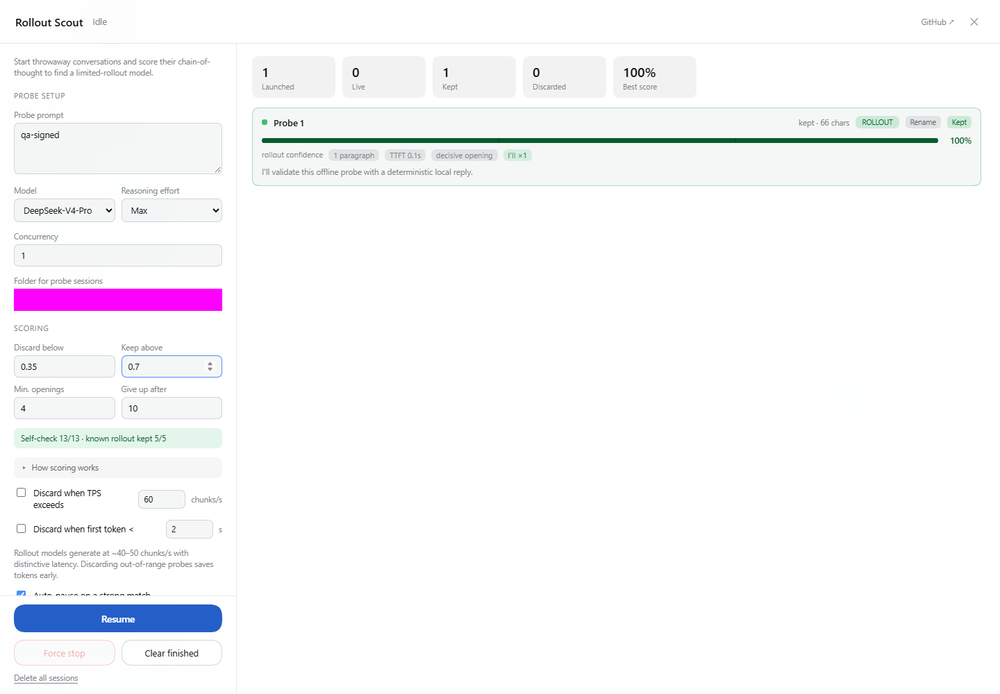
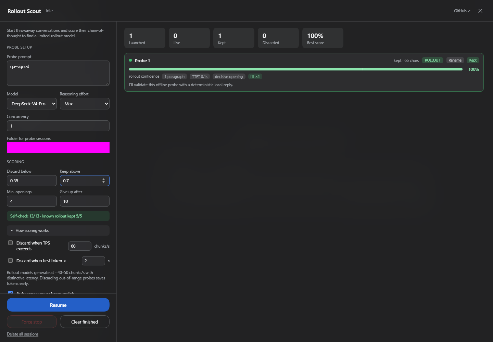
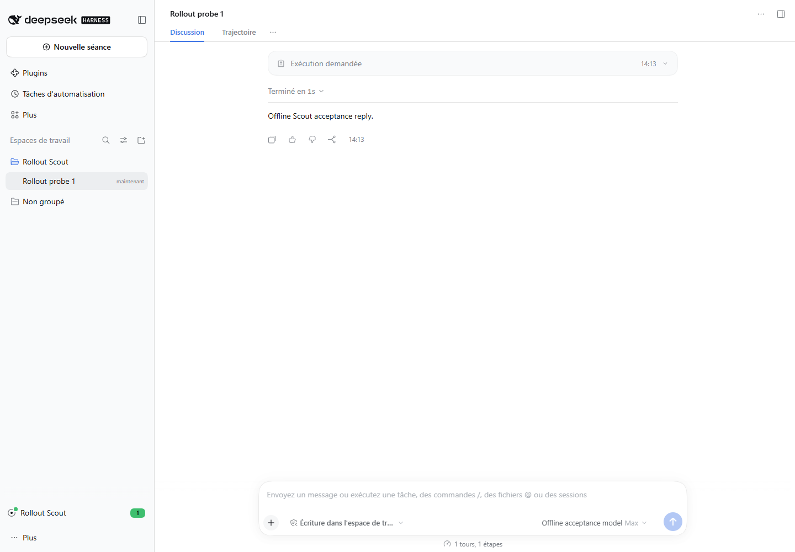

# Official DSH 0.2.2-rc.1 implementation evidence

Event: `compatibility:rollout-scout:dsh-0.2.2-rc.1`, 2026-11-06.
Integration base: `e4e243db3f9baf914ed1b05139e70d5a8a0ca623` (plugin 1.8.0).
Official upstream [release](https://github.com/deepseek-ai/deepseek-harness/releases/tag/dsh-v0.2.2-rc.1)
commit: `66491b05e3f05ad35bcdd4f6cd7ed26041d9e3db`.
The npm package declares Node `>=24.9.0`; latest-host QA uses Node **24.13.0**.
Older official hosts use Node **22.19.0**.

## Reproduction and implementation

The unchanged base was packed as `dsh-plugin-rollout-scout-1.8.0.tgz` and installed
alongside `@deepseek-ai/dsh@0.2.2-rc.1` with npm `--strict-peer-deps` in the owned
`baseline-strict` prefix. npm 10.9.3 returned **ERESOLVE**: its peer range
`>=0.2.0-rc.2 <0.3.0-0 || 0.2.1-rc.2 || 0.2.1-rc.5` excludes the new prerelease.
The fix explicitly adds `|| 0.2.2-rc.1` to both the peer and engine declarations
and the lockfile root. No version or README compatibility text was changed.

`npm run check:peers` now packs the actual plugin and runs npm's strict peer
resolver independently against all four named official hosts, without installing
or starting runtime dependencies. Actual latest-host strict installation is also
checked separately. No prerelease-widening flag or legacy peer override is used.

Real-browser screenshot inspection also exposed a pre-existing light-theme
defect in 1.8.0: the console and preflight dialog referenced undefined
`--dsw-alias-bg-primary`. That forced a dark fallback behind the host's dark
light-theme text. All four inspected official theme packages define
`--dsw-alias-bg-layer-1` and omit `--dsw-alias-bg-primary`. The fix replaces the
three surface-token references and regenerates `lib/client.js`.

The browser regression was run **before** this CSS fix: the primary-text
contrast assertion failed with foreground `rgb(15, 17, 21)`, background
`color(srgb 0.0862745 0.0862745 0.101961 / 0.94)`, contrast **1.217191:1**.
After the first fix, the primary-text-only Edge check passed at **18.90:1 light** and
**15.18:1 dark**. This did not establish semantic badge, status or warning contrast;
independent review subsequently found those failing (see the round-two record).
The original assertion samples computed colors after entry animations
finish and composites the translucent surface against the host base.

## Validation results

- `npm ci`: pass, lockfile installs without modification.
- Full `npm test`: pass on Node 22.19.0 and 24.13.0.
- `node --test scripts/npm-publish.test.mjs`: all 10 checks pass; this only tests
  publication helpers, and performs no publication.
- `npm run build`, package check (11 runtime files), generated-bundle consistency,
  and `git diff --check`: pass.
- `npm run check:peers`: all four official versions pass npm strict resolution.
- Actual `npm install --strict-peer-deps` of the fixed packed 1.8.0 into the owned
  latest runtime: pass; `npm ls` confirms DSH 0.2.2-rc.1 deduplicated under Scout.
- Official 0.2.0-rc.2, 0.2.1-rc.2, 0.2.1-rc.5 and 0.2.2-rc.1 fresh/restart
  acceptance: pass. Positive plain/signed catches, exact prose count, raw signed
  persistence, max reasoning effort, producer source, automatic pause, cold
  rename, protected cleanup and explicit deletion are asserted.
- Added official-host negative case: live `Let me` classification, Pause reaching
  the adapter's real AbortSignal, and deletion only after host teardown. A separate
  persisted same-folder conversation (even with the same source kind) is absent
  from Scout's manifest and survives cleanup and restart orphan sweeping.
- Restart retains Keep, preserves failed probes through the three-error breaker,
  then safely removes the owned failures while retaining both protected and
  unowned logs.
- Real headless Edge **156.0.4314.58**, latest official Web host: launcher,
  French-host English fallback, signed prose preview, light/dark contrast,
  1440x1000 and 1000x760 action-footer geometry, retained-card navigation to the
  actual persisted response; zero page or console errors.






## Published API inspection

Inspected installed official rc.5 and 0.2.2-rc.1 package code, including:

- `dsh-agent/lib/types/index.js`: create/resume still obtain caller ownership
  through `this.ctx` and `getTraceable`; the latest registry adds its turn-boundary
  projection. Setup remains awaited and `installModelSelection` remains exported.
- `dsh-agent-loop/lib/index.js`: `followup` queues the next turn; `cancel` clears
  the inbox and aborts the active phase; live chunks still emit
  `agent/assistant-stream` with `{ frame }`. The plugin consumes these directly.
- `dsh-session-format-v3-to-v4`: native admission still rejects generic `plugin`
  sources and accepts producer-owned kinds. Scout already uses its own name.
- `dsh-llm-deepseek/lib/index.js`: `thinking_delta` becomes `reasoning-delta`;
  native `signature_delta` goes into replay metadata without a reasoning chunk.
  Scout's existing leading-envelope filter also remains necessary for providers
  that deliver signatures inline; fixtures exercise plain and fragmented envelopes.
- `dsh-session-persistence-jsonl`: `locate(meta)` still returns the JSONL path;
  write handles are drained/flushed at disposal. Acceptance checks actual logs,
  cold observations, deletion, and restart rather than assuming API shape proves it.
- `dsh-api-session-controller`: control updates now group projection changes per
  event and catalog summaries restrict their projection subset. Scout does not
  parse those transport internals; its client uses `sessions.refresh()`.
- `dsh-client-ui-workspace`: `openSession(target)` still delegates to the main-pane
  reveal/navigation path. Verified by clicking the retained Scout card in Edge.
- `dsh-client-locale`: new `ja/es/fr/de/ru/pt` catalog entries fall back to English.
  Scout's existing English/Chinese dictionaries require no new translations.

The repository has a Node/OS unit-test matrix, but no existing official-host
acceptance CI matrix. No unrelated CI infrastructure was added.

## Reusable reviewer commands

All commands run with the task checkout as working directory. Substitute the
owned prefix below for `$qa`; use absolute paths when running from a Home thread.

```powershell
$qa = (Resolve-Path '..').Path # owned task prefix containing this checkout
$node24 = "$qa/tools/node_modules/node/bin/node.exe"
$npmCli = Join-Path (Split-Path (node -p 'process.execPath')) 'node_modules/npm/bin/npm-cli.js'
$env:DSH_QA_SANDBOX_ROOT = $qa
npm ci
npm test
& $node24 $npmCli test
node --test scripts/npm-publish.test.mjs
npm run build
npm run check:client
npm run check:package
& $node24 $npmCli run check:peers

# Latest host and real Edge browser, deterministic local model only.
$env:DSH_QA_MODULES = "$qa/runtime-0.2.2-rc.1/node_modules"
$env:DSH_QA_BROWSER_MODULE = "$qa/repo/scripts/check-dsh-browser.mjs"
$env:DSH_QA_PLAYWRIGHT = "$qa/tools/node_modules/playwright-core/index.mjs"
$env:DSH_QA_BROWSER_EXE = 'C:/Program Files (x86)/Microsoft/Edge/Application/msedge.exe'
# Keep reviewer screenshots out of tracked implementation evidence by default.
$env:DSH_QA_SCREENSHOTS = "$qa/reviewer-screenshots"
& $node24 scripts/run-dsh-acceptance.mjs

Remove-Item Env:DSH_QA_BROWSER_MODULE
foreach ($version in @('0.2.0-rc.2', '0.2.1-rc.2', '0.2.1-rc.5')) {
  $env:DSH_QA_MODULES = "$qa/runtime-$version/node_modules"
  node scripts/run-dsh-acceptance.mjs
  if ($LASTEXITCODE -ne 0) { throw "Acceptance failed: $version" }
}
```

The acceptance runner creates a unique profile and a junction from its
`node_modules/@deepseek-ai` to the selected owned official runtime. It copies the
plugin into the profile so imports resolve that runtime. Its `finally` stops the
host and removes the sandbox/junction; the browser leg also stops its owned Edge
process and control server. Runtime installations, tools and fixtures remain
available under the owned prefix for independent review.

## QA ownership and cleanup

Owned prefix: `<QA_PREFIX>` (the parent directory of the task checkout).
The following are actual process/port observations, including unsuccessful QA
setup iterations. Every listed host and browser was stopped. Sandbox names below
have the common prefix `rollout-scout-dsh-qa-` within the owned prefix.

| Run | Sandbox suffix | Host PID:port (fresh / restart) | Edge PID / control port |
| --- | --- | --- | --- |
| Original latest host acceptance | BSwzrx | 9700:52520 / 56148:52526 | none |
| Unowned-fixture setup failure, 0.2.0-rc.2 | 1mS4tw | 60724:58997 | none |
| Unowned-fixture setup failure, rc.2 | ifbCzu | 113128:56710 | none |
| Unowned-fixture setup failure, rc.5 | ckG6d0 | 34560:56719 | none |
| Browser bootstrap setup failure | xnhzsn | 18920:60414 | 30120 / not recorded |
| Negative-case setup failure | C3Glmw | 102688:62898 | none |
| Preview notice interrupted navigation | Yl3GEK | 103100:60570 | 82612 / not recorded |
| Extended 0.2.0-rc.2 pass | 9L3BPh | 119728:60568 / 4120:60571 | none |
| Extended 0.2.1-rc.2 pass | OH4LqZ | 105276:55290 / 17580:55302 | none |
| Extended 0.2.1-rc.5 pass | XtAxVU | 58524:54436 / 67696:55363 | none |
| Latest navigation pass before contrast regression | cBelkm | 83956:55395 / 29668:56798 | 102480 / 55399 |
| Confirmed pre-fix contrast failure | tzAg04 | 68164:49694 | 111280 / 49697 |
| Latest final light/dark + lifecycle pass | m2Fl7l | 108100:51649 / 32080:51684 | 60292 / 51651 |

Edge used debugging pipes, with ephemeral Playwright control-server ports.
Browser profiles were `playwright_chromiumdev_profile-YqzkEF`, `-214vCQ`,
`-xpEJIP`, and `-2IgTRS` inside their respective sandboxes. The initial helper
incorrectly let Playwright create `%TEMP%/playwright_chromiumdev_profile-Q2xr9k`;
that profile was removed on close, and the helper was corrected to set the parent
process temporary-directory environment while launching. The first two control
ports were not recorded; their servers closed with their browser helpers.

Cleanup inspection found no listed QA PIDs, no task-prefix Node/Edge processes,
no listeners on any recorded port, no remaining `rollout-scout-dsh-qa-*`
sandboxes/junctions, and no initial out-of-prefix browser profile. No user profile
or main-checkout junction was used. Reusable directories are `runtime-<version>`
for the four hosts, `tools` (Node 24, playwright-core and semver), `fixed-artifacts`,
and the task checkout. No live watcher or external process is required.

## Limits

Windows official Web hosts and deterministic local `qa-local` adapter only.
No real account models, remote classification accuracy, Native Desktop, Linux,
or production quotas were tested. Prior hosts receive fresh/restart server
acceptance; browser checks target latest official DSH. Local npm audit reported
the existing 16 dependency advisories (8 moderate, 8 high); this compatibility
change does not update the dependency tree. Release versioning, README updates,
CI publication, and release actions belong to the subsequent Writer stage.
